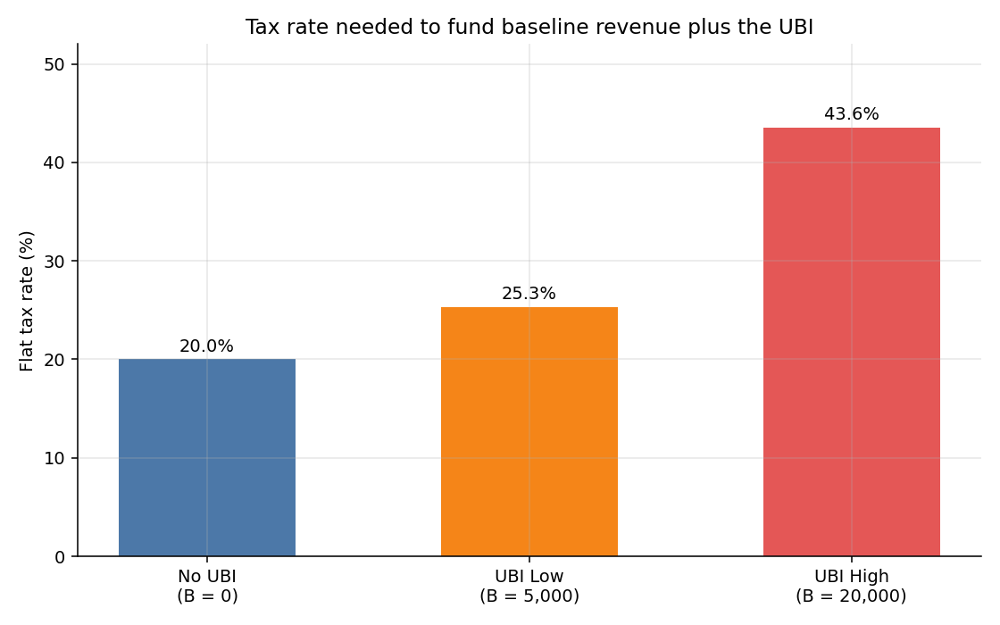
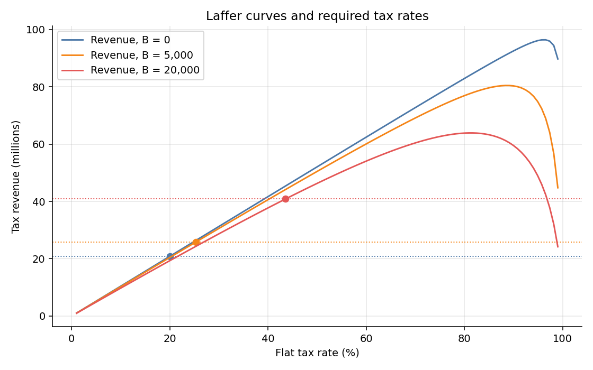
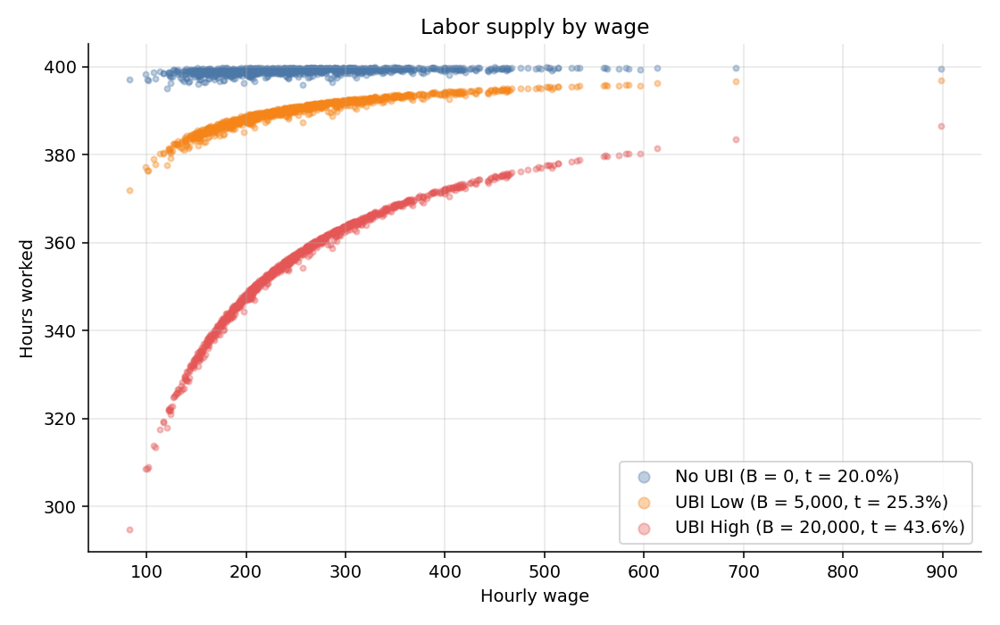
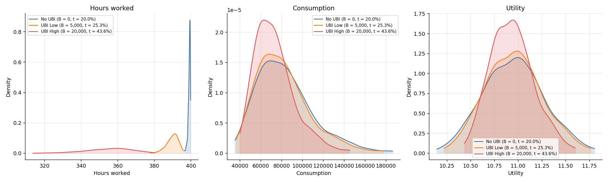
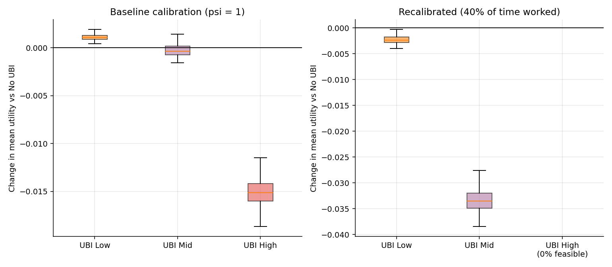

# UBI labor-supply simulation

[](https://github.com/Dmkostek/ubi-labor-supply-simulation/actions/workflows/ci.yml)

A simulation of what a **revenue-neutral universal basic income (UBI)** does to hours worked, consumption and welfare in a population of 1,000 agents who differ in wages and non-labor income. Each agent chooses how much to work; the government sets a flat tax high enough to keep its baseline revenue *and* pay everyone a UBI.

## Key findings

| | No UBI | UBI 5,000 | UBI 20,000 |
|---|---|---|---|
| Flat tax rate that pays for it | 20.0% | 25.3% | 43.6% |
| Total hours worked | 399,075 | 389,786 (−2.3%) | 354,956 (−11.1%) |
| Gini of consumption | 0.185 | 0.177 | 0.147 |
| Utility of the worst-off 10% | 10.394 | 10.440 | 10.568 |
| Mean utility | 10.953 | 10.953 (+0.0008) | 10.937 (−0.0159) |

* **UBI redistributes.** Inequality falls (the Gini and the spread of utility both shrink) and the worst-off 10% gain at both UBI levels.
* **UBI does not raise average welfare here.** Mean utility is flat at the low level and falls at the high level, because the tax needed to fund it costs more in lost work and consumption than the transfer adds. Across 100 random populations the high level never beats No UBI (0 of 100), and the low level is a tiny gain (+0.0011, positive in all 100).
* **The 20,000 UBI is fragile.** If agents have a realistic labor-leisure trade-off (the average agent works 40% of their time rather than 99.8%), no flat tax can raise enough to fund it. See [Sensitivity](#sensitivity-a-realistic-labor-leisure-trade-off).



## The model

Each agent *i* has a wage $w_i$ and non-labor income $y_i$ (independent lognormals; wage mean 260, sd 90; non-labor mean 500, sd 300). They choose the share of their time endowment $T = 400$ to work, $m \in [0, 1]$:

$$U(m) = \ln C - \psi \, \frac{e}{1+e}\, m^{1 + 1/e}, \qquad C = y_i + B + w_i\, T\, m\,(1 - t)$$

* $e = 0.5$ is the Frisch elasticity, $B$ the UBI transfer, $t$ a flat labor-income tax, and $\psi$ a scale for the disutility of work ($\psi = 1$ in the baseline).
* The first-order condition $\dfrac{a}{c + a m} = \psi\, m^{1/e}$ (with $a = w_i T (1-t)$, $c = y_i + B$) has exactly one root, because the left side falls and the right side rises in $m$. It is solved by vectorised bisection, so all 1,000 agents are solved at once, with hours capped at the time endowment.
* **Revenue neutrality:** for each UBI level the tax $t$ is chosen so that revenue equals *baseline revenue + N·B*. Revenue is a Laffer curve in $t$ (it rises, peaks, then falls), so a plain bisection on [0, 1] is invalid. The solver finds the peak first and brackets the root on the rising branch. If the target is above the peak, the policy is infeasible and the code says so instead of returning a number.



### Behavioral response

Low-wage agents cut hours the most, since the UBI is large relative to their earnings: under the 20,000 UBI the lowest-wage 10% work 17.3% fewer hours than without it, the highest-wage 10% only 6.2% fewer.




## Sensitivity: a realistic labor-leisure trade-off

With the baseline parameters ($\psi = 1$) the average agent works **399 of 400 hours** and none works less than 98.8%, so the labor-leisure trade-off is nearly absent. As a sensitivity check I calibrate $\psi$ so the average agent works 40% of their time at baseline, and add a 10,000 UBI level.

| (recalibrated, $\psi$ = 15.4) | No UBI | UBI 5,000 | UBI 10,000 | UBI 20,000 |
|---|---|---|---|---|
| Flat tax rate | 20.0% | 33.9% | 50.9% | **infeasible** |
| Gini of consumption | 0.184 | 0.163 | 0.132 | — |
| Utility of the worst-off 10% | 9.500 | 9.611 | 9.706 | — |
| Change in mean utility | — | −0.0029 | −0.0342 | — |

The 20,000 UBI would cost 20M on top of 8.4M of baseline revenue; the most any flat tax can raise in this economy is 19.97M (at a 75% rate). The qualitative picture matches the baseline (redistribution yes, average welfare gain no) but is stronger.

### Robustness across random populations

The results are not an artefact of one random draw: 100 independent populations per calibration.

| Calibration | Scenario | Mean Δ utility vs No UBI | Share of seeds with Δ > 0 |
|---|---|---|---|
| Baseline ($\psi$ = 1) | UBI Low | +0.0011 | 100% |
| Baseline ($\psi$ = 1) | UBI Mid | −0.0003 | 30% |
| Baseline ($\psi$ = 1) | UBI High | −0.0151 | 0% |
| Recalibrated (40% of time) | UBI Low | −0.0023 | 0% |
| Recalibrated (40% of time) | UBI Mid | −0.0334 | 0% |
| Recalibrated (40% of time) | UBI High | infeasible in 100% of seeds | n/a |



Full tables: [`results/RESULTS.md`](results/RESULTS.md) and the CSVs in [`results/`](results).

## Validation

* Every scenario reaches its revenue target to numerical precision (tested).
* The first-order condition holds for every agent to within $10^{-9}$ (tested).
* The vectorised solver agrees with an independent per-agent Newton solver.
* Each scenario is solved with its own tax rate, hours and UBI; welfare is never computed from another scenario's values (tested).
* 19 unit and regression tests run in CI on Python 3.10, 3.11 and 3.12.

## Reproduce

```bash
pip install -r requirements.txt
python -m pytest -q                 # 19 tests
python -m ubi_sim.run               # regenerates figures/ and results/ (~30 s)
```

The walk-through notebook is [`notebooks/ubi_simulation.ipynb`](notebooks/ubi_simulation.ipynb). Population draws use `RandomState(42)`, so every number above is reproducible.

```
ubi_sim/model.py   population, exact solver, revenue-neutral tax, welfare metrics
ubi_sim/plots.py   figures
ubi_sim/run.py     reproduces every table and figure
tests/             unit and regression tests
notebooks/         narrated walk-through with outputs
results/           generated tables (markdown + CSV)
```

## Limitations

* **Partial equilibrium.** Wages are fixed; there is no labor demand, so the "labor cost index" (baseline hours ÷ hours) in the results tables is a stylised indicator, not a wage prediction.
* **Static, one-period model** with a flat labor tax, no extensive-margin (participation) choice and no capital, migration or automation responses.
* **Welfare = utilitarian sum of log-utilities.** Utility is ordinal, so conclusions about *average* welfare depend on that choice; the distributional measures (bottom decile, Gini) do not.
* **Illustrative calibration**, not matched to any country's data; wages and non-labor income are drawn independently.

## Author

Diyar Kostek. Started as coursework at BI Norwegian Business School in 2025 and since rebuilt and extended.

Released under the [MIT License](LICENSE).
